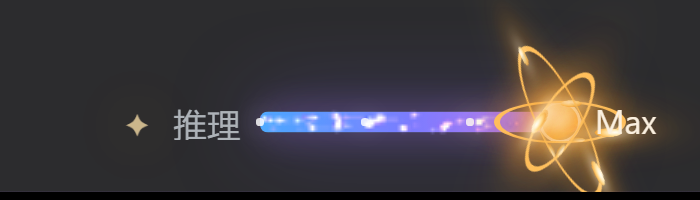
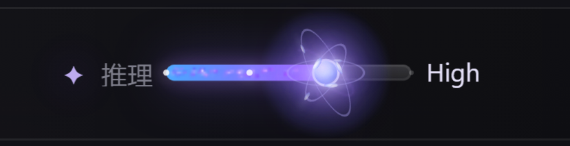
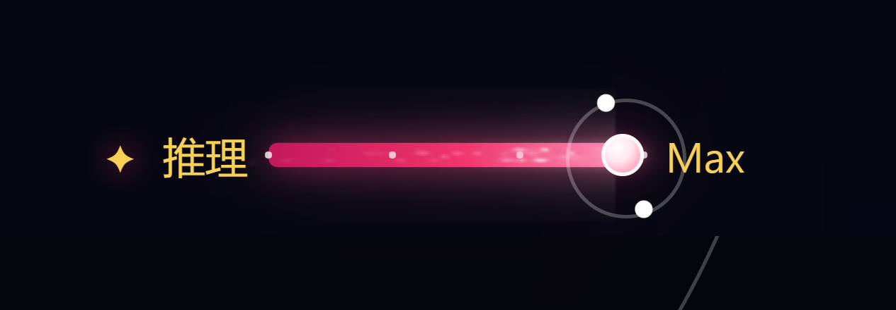
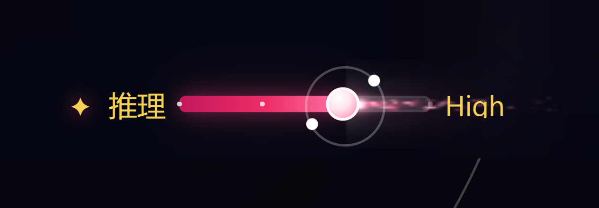
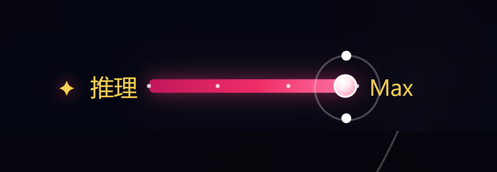

# dsh-plugin-reasoning

[](https://github.com/topics/dsh-plugin)
[](https://github.com/topics/deepseek-harness)
[](LICENSE)

给 [DeepSeek Harness](https://github.com/deepseek-ai)（DSH）Web GUI 的 **推理强度选择模块**：一个基础圆形滑块，外加两个可以随时切换的视觉特效。

本仓库是 **三个 DSH 插件的合集**，对应「推理强度选择模块」及其两个外观特效：

| 插件 | 包名 | 作用 |
|---|---|---|
| 推理模块 | `dsh-reasoning-module` | 推理强度滑块本体：拖拽 / 键盘调档、档位自适应、提交到当前会话 |
| 特效一 | `dsh-reasoning-fx-one` | 蓝紫粒子拖尾 + 暖金卢瑟福原子（3 条椭圆轨道、9 个电子、原子核光晕） |
| 特效二 | `dsh-reasoning-fx-two` | 贯穿整个模块的常驻玫红喷气尾流 + 两枚中心对称白色光点沿正圆轨道环绕 |

推理模块本身**不包含任何粒子、光晕或原子特效**；外观全部来自特效子插件。两个特效互斥——同一时间最多只有一个处于生效状态。

---

## 预览

### 推理模块 + 特效一

<p align="center"></p>

<p align="center"></p>

### 推理模块 + 特效二

<p align="center"></p>

<p align="center"></p>

<p align="center"></p>

---

## 功能

### 推理模块（`dsh-reasoning-module`）

- **档位自适应**：直接读取当前会话模型 `reasoning.efforts`，不写死档位数量或名称。3 档落在 0 / 50% / 100%，4 档落在 0 / 33% / 66% / 100%，以此类推。
- **拖拽式切换**：按住圆形滑块拖动时连续预览，松手吸附到最近档位并提交给当前会话。
- **键盘可操作**：`←` / `→` / `↑` / `↓` 调一档，`PageUp` / `PageDown` 也可，`Home` / `End` 直达首尾；松开按键提交，`Esc` 取消。
- **提交态可视化**：提交中显示 pending，失败保留原档位并短暂标红；模型没有推理档位时整个控件自动隐藏。
- **可访问性**：`role=slider` + `aria-valuemin/valuemax/valuenow/valuetext`，焦点态、悬停态、禁用态齐全。
- **不侵入宿主**：只挂在 `conversation.input.right` 插槽（order 12），通过 DSH 的模型目录服务提交选择。

### 特效一（`dsh-reasoning-fx-one`）

- 蓝紫渐变粒子拖尾铺满进度轨道（固定 120 粒子池循环复用）；
- 暖金色 **3 条椭圆电子轨道、9 个电子**绕原子核旋转；
- 暖金原子核 + 柔和光晕，完整延伸到右侧档位文字后方，不被读数区裁切；
- 卸载时完整移除画布 / 轨道 / 电子节点，不留残余样式与动画。

### 特效二（`dsh-reasoning-fx-two`）

- 滑块作为喷口，**常驻**喷出白热核心 + 玫红粒子尾流，长度贯穿整个 `.rps-control` 模块；
- 两枚完全相同的 5px 纯白圆点（无光晕），沿 32px 半透明白色正圆轨道**同一平面**环绕；
- 两点始终 180° 中心对称、大小一致、到滑块中心距离相等，转速约 2.4–3.2s/圈（推理强度越高略快）；
- 滑块本体无光晕、无 `::before` 光晕层；进度条为深玫红 → 玫红 → 粉红渐变；
- 尾流常驻但极轻：固定 170 粒子池 + 预渲染精灵，静止 2s 实测主线程约 0.6ms（≈0.3ms/s）；
- 卫星轨道交给合成器（单个 CSS `transform: rotate()` 动画）；标签页隐藏自动停表；`prefers-reduced-motion: reduce` 时轨道停用、尾流不绘制。

---

## 目录结构

```
dsh-plugin-reasoning/
├─ dsh-reasoning-module/     # 推理模块（基础滑块 + 特效互斥容器）
│  ├─ package.json
│  ├─ cordis.patch.yml       # 组合包补丁：插入 特效一 / 特效二 两个子组件行
│  ├─ src/index.js           # Host 半边：把 reasoning-fx-* 行收敛到最多启用一个
│  ├─ lib/client.js          # 浏览器半边：滑块 UI + CSS + reasoningModule 服务
│  ├─ locale/{zh,en}.json    # 插件页显示名
│  └─ icon.svg
├─ dsh-reasoning-fx-one/     # 特效一（无 Host 逻辑，纯 client 特效）
│  ├─ package.json
│  ├─ src/index.js           # Host 占位，仅为让 Loader 行可挂载
│  ├─ lib/client.js          # CSS + 粒子画布 + 卢瑟福原子
│  ├─ locale/{zh,en}.json
│  └─ icon.svg
├─ dsh-reasoning-fx-two/     # 特效二（无 Host 逻辑，纯 client 特效）
│  ├─ package.json
│  ├─ src/index.js
│  ├─ lib/client.js          # CSS + 长尾流 canvas + 白点/白色轨道
│  ├─ locale/{zh,en}.json
│  └─ icon.svg
├─ preview/                  # README 截图
└─ LICENSE
```

三个包都是 **纯 JavaScript**（无构建步骤、无运行时依赖），clone 后即可直接 link 进 DSH profile。

---

## 安装

### 前置条件

- DSH Desktop / DSH Web GUI（开发验证于 **DSH 0.2.2-rc.1**，插件 API 面向 DSH 0.2.x）；
- Node.js ≥ 20（DSH 自带运行时即可）；
- 模型适配器提供推理档位（`reasoning.efforts`），否则推理模块不会显示。

> 以下以 profile 目录 `~/.dsh/profiles/<profile>`（Windows：`C:\Users\<你>\.dsh\profiles\<profile>`）为例。
> 本仓库位于 `<REPO>`。

### 1. 把三个包登记为 profile 依赖

在 profile 的 `package.json` 的 `dependencies` 中追加（Windows 绝对路径示例）：

```json
{
  "dependencies": {
    "dsh-reasoning-module": "link:<REPO>/dsh-reasoning-module",
    "dsh-reasoning-fx-one": "link:<REPO>/dsh-reasoning-fx-one",
    "dsh-reasoning-fx-two": "link:<REPO>/dsh-reasoning-fx-two"
  }
}
```

并在 profile 的 `node_modules` 下为三个包建立链接（二选一）：

- 在 profile 目录执行 `pnpm install`（或 `npm install`），由包管理器建立 `link:`；
- 或手工建立目录链接：Windows `mklink /J`、macOS / Linux `ln -s`。

### 2. 选中推理模块组合包

在 profile 的 `package.json` 中把 `dsh-reasoning-module` 加入 `dsh.profile.bundles`：

```json
{
  "dsh": {
    "profile": {
      "bundles": ["@deepseek-ai/dsh-base", "...", "dsh-reasoning-module"]
    }
  }
}
```

这一步会让 `dsh-reasoning-module/cordis.patch.yml` 生效，从而把「特效一」「特效二」作为子组件行插入。

### 3. 把推理模块挂载到界面

再把「推理模块」这一行插进组合树。**二选一**：

- **如果你的组合里已经有父插件插入了 `reasoning-module` 行**（例如作者的「外观与特效」母插件）：无需重复操作，重启即可；
- **否则**：编辑 profile 的 `cordis.patch.yml`（用户补丁层，在 bundle 层之后应用），追加：

```yaml
- insert:
    - id: reasoning-module
      name: dsh-reasoning-module
```

> 注意：`id` 与 `name` 不要与已有行重复。若你的 `cordis.patch.yml` 里已有 `- insert:` 列表，把这一项追加到同一个列表即可。

### 4. 重启 DSH

菜单「重启应用和 Host」，或直接重启 DSH 桌面端。新装插件需要重新启动后才会被加载（插件管理器会返回 `restart-required`）。

### 5. 启用 / 切换特效

侧栏 **插件** → **推理模块** 卡片 / 详情页 → **Components**：

- 打开「特效一」或「特效二」的开关即可，打开一个会自动关闭另一个；
- 两个特效都关掉就是纯滑块（无特效）；
- 关闭「推理模块」总开关或它的父层（如「外观与特效」）时，其下特效一并失效。

---

## 使用

- 滑块出现在输入框工具栏右侧（`conversation.input.right`，order 12）。
- **拖拽**：按住圆点左右拖动，松手提交；拖动过程中右侧档位文字实时预览。
- **键盘**：`←` `→` `↑` `↓` 逐档，`PageUp` / `PageDown` 逐档，`Home` / `End` 直达首尾；松开按键提交，`Esc` 放弃本次调整。
- **子会话**：子 agent 会话不显示该滑块。
- 档位名称完全来自当前模型适配器（如 `Low` / `Medium` / `High` / `Max`），切换模型后自动适配。

### 特效互斥

两层互斥，保证同一时间最多只有一个推理特效处于生效状态：

1. **Host 行级（硬互斥）**：`dsh-reasoning-module` 的 Host 半边监听 `plugin-manager/changed`，把所有 `patchId` 以 `reasoning-fx-` 开头的已启用行收敛到最多一个（新打开的那个保留）；
2. **Client 运行时（互斥容器）**：浏览器半边的 `reasoningModule` 服务保证同一时间最多一个已注册特效处于激活状态。

切换是**行级硬切换**（打开一个立即卸载另一个），没有渐隐过渡。

---

## 给插件作者的接口

推理模块在浏览器端通过 `ctx.provide('reasoningModule', api)` 暴露一个 Client Service，新增特效只需注册：

```js
const dispose = ctx.reasoningModule.register({
  id: 'reasoning-fx-mine',      // 全局唯一
  order: 30,                    // 列表顺序
  applyActive(enabled) {},      // true: 挂载特效；false: 卸载并清理
  isActive() {},                // 当前是否已挂载
});
// 取消注册 / 热卸载时调用 dispose()
```

服务自动保证「最多一个特效激活」；也可以用 `select(id)` 显式切换、`getActiveId()` / `snapshot()` 读取状态、`subscribe(listener)` 订阅变化。

**注意**：插件的 Loader 行 `id` 必须以 `reasoning-fx-` 开头，才会被 Host 半边的行级互斥规则纳入管理。

---

## 实现要点

### 层级

```
dsh-reasoning-module（组合包：基础滑块 + 互斥容器）
├─ 特效一  dsh-reasoning-fx-one
└─ 特效二  dsh-reasoning-fx-two
```

- 「推理模块」自身是一个组合包：其 `cordis.patch.yml` 把两个特效插入为子组件行；
- 推理模块自身由上层补丁（「外观与特效」母插件，或 profile 用户补丁）插入；
- 关闭上层或推理模块时，其下特效一并失效。

### 性能设计

| | 特效一 | 特效二 |
|---|---|---|
| 粒子 | 固定 120 粒子池，canvas rAF | 固定 170 粒子池 + 预渲染精灵，canvas rAF |
| 轨道 | CSS 椭圆轨道 + 电子（合成器动画） | 单个 CSS `transform: rotate()` 合成器动画 |
| 空闲开销 | canvas 常驻 rAF | 常驻 rAF，但主线程实测 ≈0.3ms/s（静置 2s 仅 0.6ms） |
| 页面隐藏 | `visibilitychange` 停表 | `visibilitychange` 停表 |
| 减少动态 | `prefers-reduced-motion` 停用粒子/动画 | 轨道停用、尾流不绘制，保留静态白点 + 半透明轨道 |
| 卸载 | 完整移除节点、观察器、rAF、样式 | 同左（已在真实 GUI 验证热卸载） |

---

## 兼容性与已知限制

- 开发与验证环境：DSH Desktop **0.2.2-rc.1**（Web GUI，Windows）；插件只使用 DSH 公开的 client 服务（slots / locale / modelDirectories / theme），不修改宿主源码。
- 推理模块依赖模型适配器公布的 `reasoning.efforts`；没有推理元数据的模型不显示滑块。
- 两个特效是行级硬切换，无渐隐过渡。
- 特效二的长尾流覆盖整个 `.rps-control` 绘图区（在文字下层）；`prefers-reduced-motion` 下不绘制尾流。
- 若同时启用了会强制改写输入区配色的其它插件（例如给输入框文字加 `!important` 颜色），可能覆盖滑块图标/档位文字的颜色。
- 本仓库只包含「推理强度选择」这条功能线，不包含 DSH 的「外观与特效」母插件或其它外观子插件。

---

## 开发

没有构建步骤：改 `lib/client.js` 后重启 DSH（或按 DSH 的 HMR 提示刷新）即可看到效果。

```bash
# 语法自检（不依赖 DSH）
node --check dsh-reasoning-module/lib/client.js
node --check dsh-reasoning-fx-one/lib/client.js
node --check dsh-reasoning-fx-two/lib/client.js
```

- 浏览器半边按 DSH 模块加载器格式手写为 `window.__ModuleLoader__.load({ id, factory })`，React 通过 `require('react')` 从宿主模块表获取，因此文件里不能出现 JSX / ESM import。
- 所有视觉开关都通过 `reasoningModule` 服务注册，不使用定时器轮询。

---

## 常见问题

**Q：装完后侧边栏插件页看不到「推理模块」卡片？**
A：检查三件事：三个包是否已建立 `node_modules` 链接；`dsh.profile.bundles` 是否包含 `dsh-reasoning-module`；用户补丁层是否插入了 `reasoning-module` 行。最后重启 DSH。

**Q：插件页有卡片，但详情页 Components 是 0？**
A：说明组合包补丁层没有生效——确认 `dsh-reasoning-module` 是作为 **bundle**（`dsh.profile.bundles`）加入，而不是只被插成一行。

**Q：滑块不显示？**
A：当前会话的模型适配器没有公布 `reasoning.efforts`，或当前是子 agent 会话。换一个带推理档位的模型试试。

**Q：两个特效都想关掉？**
A：在「推理模块 → Components」里把两个特效行都关掉即可，滑块功能不受影响。

**Q：切换特效后旧特效还有残影？**
A：请升级到本仓库当前版本；两个特效都会在 `applyActive(false)` 时完整销毁 canvas / 节点 / 样式 / rAF。

---

## License

[MIT](LICENSE) © 2026 ruozhi5067
