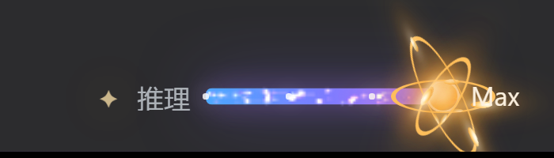

# 特效一（dsh-reasoning-fx-one）

「推理模块」（`dsh-reasoning-module`）的第一个视觉特效子插件，作为该组合包的子组件插入。

它通过 `reasoningModule` Client Service 注册自己（`id: "reasoning-fx-one"`）：

- 激活时向 `.rps-control` 的 `.rps-fx-layer` 挂载粒子画布、暖金卢瑟福原子轨道和电子；
- 停用时完整移除这些节点，不留下任何残余样式或动画；
- 通过已有的 `.rps-control` CSS 变量读取进度与强度，不侵入基础滑块的 React 状态。

<p align="center"></p>

## 视觉内容

- **蓝紫渐变粒子拖尾**：进度轨道上铺满蓝紫粒子（固定 120 粒子池，预分配复用）；
- **暖金色 3 条椭圆电子轨道、9 个电子**，绕中心原子核旋转（CSS 合成器动画）；
- **暖金原子核 + 柔和光晕**；
- 完整的轨道和光晕延伸到右侧档位文字后方，不被读数区裁切。

## 性能与降级

- 粒子画布使用固定 120 粒子池，不逐帧创建对象；
- 轨道 / 电子是 CSS 动画，运行在合成器线程；
- 标签页隐藏时停止 canvas rAF，恢复可见后继续；
- `prefers-reduced-motion: reduce` 时停用粒子与旋转动画；
- 关闭特效行时完整销毁 canvas、轨道节点、观察器、rAF 与注入样式（已在线验证热卸载）。

## 层级与开关

```
推理模块 › 特效一
```

- Loader 行 id：`reasoning-fx-one`（写在 `dsh-reasoning-module/cordis.patch.yml`）；
- 在「推理模块」组合包详情页的 **Components** 中可单独启停；
- **互斥**：推理模块的 Host 半边把 `reasoning-fx-*` 行收敛到最多一个启用——打开「特效一」会自动关闭「特效二」，反之亦然；
- 本包不单独出现在已安装插件列表中，以「推理模块」组合包的子组件形式存在。

## 与「特效二」的差异

| | 特效一 | 特效二 |
|---|---|---|
| 滑块装饰 | 暖金卢瑟福原子（3 轨道 9 电子，CSS） | 两枚白色光点 + 半透明白色正圆轨道（同一平面、中心对称、无光晕，CSS） |
| 痕迹 | 蓝紫粒子铺满进度轨道（canvas） | 常驻玫红长尾流，贯穿整个模块、离子更稀疏 |
| 色调 | 蓝紫 + 暖金 | 深玫红 → 玫红 → 粉红 |

## 安装

本包属于 [dsh-plugin-reasoning](https://github.com/ruozhi5067/dsh-plugin-reasoning) 仓库，随「推理模块」一起安装（三个包都需要登记为 profile 依赖），安装步骤见仓库根目录的 [README](https://github.com/ruozhi5067/dsh-plugin-reasoning#安装)。

## License

MIT © 2026 ruozhi5067
