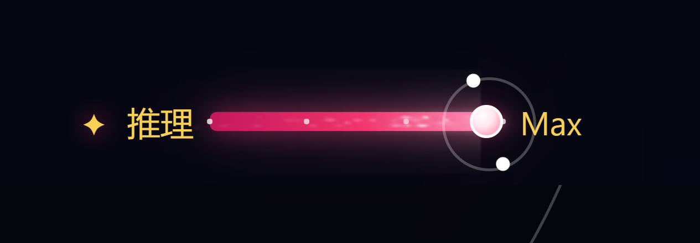
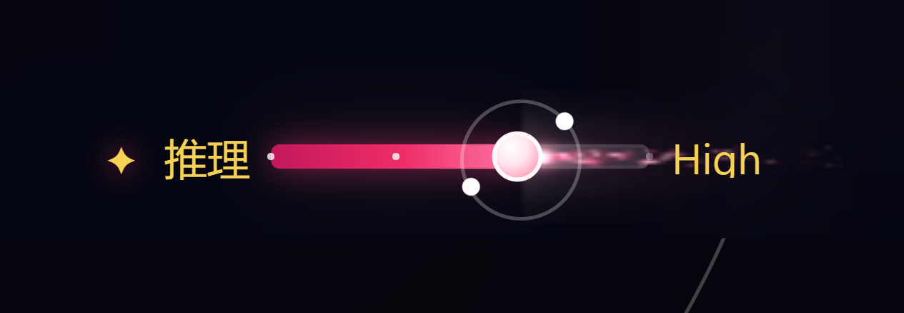
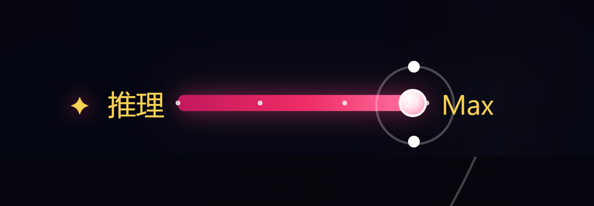

# 特效二（dsh-reasoning-fx-two）

「推理模块」（`dsh-reasoning-module`）的第二个视觉特效子插件，与「特效一」（`dsh-reasoning-fx-one`）平级，作为 `dsh-reasoning-module` 组合包的子组件插入。

它通过 `reasoningModule` Client Service 注册自己（`id: "reasoning-fx-two"`），与「特效一」共用同一套互斥规则：同一时间最多只有一个推理特效处于生效状态。

<p align="center"></p>

## 视觉内容

1. **常驻长尾流**：滑块（推理强度圆形滑块）作为喷口，持续喷出白热核心 + **玫红**粒子尾流，**长度贯穿整个滑块模块**（canvas 覆盖整个 `.rps-control`，比轨道左右各宽 54px）；静止时也保持常驻喷射，悬停 / 拖动时更亮更密，键盘调档补喷一小簇。尾流离子更稀疏、以柔光带为主：主体由两条预渲染长光带构成。
2. **两枚环绕卫星**：两枚完全相同的白色光点（5px、纯白填充、无光晕），沿半透明白色正圆轨道（32px 圆环、1px `rgba(255,255,255,.26)` 描边）在同一平面内匀速环绕；两点始终 180° 中心对称、大小一致、到滑块中心距离相等；转速约 2.4–3.2s/圈（推理强度越高略快）。
3. **无光晕滑块**：滑块本体为干净的白色圆形（带淡粉渐变），`box-shadow: none`、无 `::before` 光晕层。
4. 进度条配色为**深玫红 → 玫红 → 粉红**渐变（与特效一的「暖金原子」、此前的青蓝主题均区分开）。

<p align="center"></p>

## 低性能占用设计（已实测）

- **常驻但极轻**：尾流 rAF 在特效激活期间持续运行，但每帧只是固定粒子池的少量 `drawImage` + 2~3 条预渲染长光带；静止 2s 实测主线程仅 0.6ms（≈0.3ms/s）。
- **卫星轨道交给合成器**：两枚白色光点由单个 CSS `transform: rotate()` 转子驱动，在合成器线程运行，不占主线程；`prefers-reduced-motion: reduce` 时完全停用（保留对称静止的两点与半透明轨道，不绘制尾流）。
- **固定粒子池**：170 个预分配粒子对象循环复用，绘制用预渲染精灵（含长尾流渐变精灵），无逐帧创建渐变 / 数组；DPR 上限 2；标签页隐藏时自动停表，恢复可见后继续。

实测（desktop profile 真实 GUI，headless Chrome CDP 探针，2s 窗口）：

| 状态 | 本插件 rAF | canvas clearRect | drawImage | 主线程 TaskDuration |
|---|---|---|---|---|
| 静置（尾流常驻） | 120（≈60fps） | 120 | 5858（≈49/帧） | 0.6ms / 2s（≈0.3ms/s） |
| 悬停 | 120 | 120 | 8139 | 0.5ms / 2s |
| 拖动 | 71 | 71 | 7717 | 0.4ms / 0.79s |

## 层级与开关

```
推理模块 › 特效二
```

- Loader 行 id：`reasoning-fx-two`（写在 `dsh-reasoning-module/cordis.patch.yml`）；
- 在「推理模块」组合包详情页的 **Components** 中可单独启停；
- **互斥**：推理模块的 Host 半边把 `reasoning-fx-*` 行收敛到最多一个启用——打开「特效二」会自动关闭「特效一」，反之亦然；浏览器端 `reasoningModule` 服务再保证运行时最多一个 activate；
- 关闭本行会完整移除画布、卫星节点、样式与观察器（已在线验证热卸载）。

<p align="center"></p>

## 与「特效一」的差异

| | 特效一 | 特效二 |
|---|---|---|
| 滑块装饰 | 暖金卢瑟福原子（3 轨道 9 电子，CSS） | 两枚白色光点 + 半透明白色正圆轨道（同一平面、中心对称、无光晕，CSS） |
| 痕迹 | 蓝紫粒子铺满进度轨道（常驻 canvas） | 常驻玫红长尾流，贯穿整个模块、离子更稀疏 |
| 空闲开销 | canvas 常驻 rAF | canvas 常驻 rAF，但主线程开销 ≈0.3ms/s；卫星为纯合成器动画 |

## 已知限制

- 长尾流会覆盖整个模块的绘图区（在文字下层）；`prefers-reduced-motion` 下不绘制尾流，只保留静态白点 + 半透明轨道。
- 尾流方向跟随最近一次移动方向；静止时朝向模块内空间更大的一侧（滑块在右半区朝左喷、左半区朝右喷）。
- 推理特效互斥是行级硬切换（打开一个立即卸载另一个），没有渐隐过渡。
- 若其它插件对输入区文字使用了 `!important` 配色，可能覆盖本插件的玫红图标 / 档位文字颜色。

## 安装

本包属于 [dsh-plugin-reasoning](https://github.com/ruozhi5067/dsh-plugin-reasoning) 仓库，随「推理模块」一起安装（三个包都需要登记为 profile 依赖），安装步骤见仓库根目录的 [README](https://github.com/ruozhi5067/dsh-plugin-reasoning#安装)。

## License

MIT © 2026 ruozhi5067
